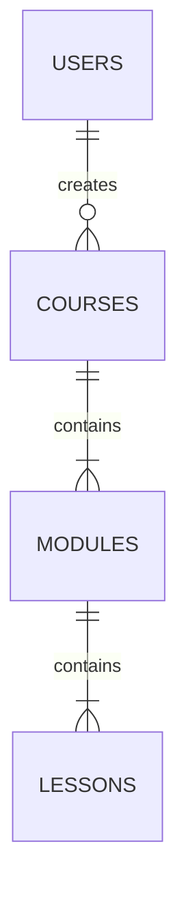
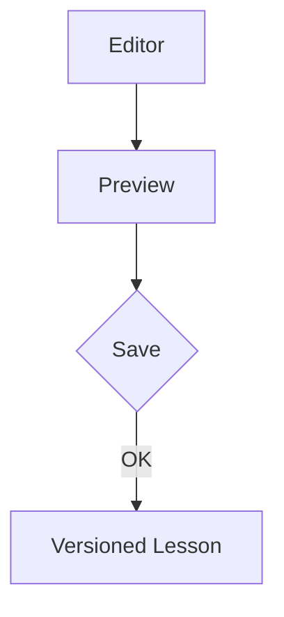
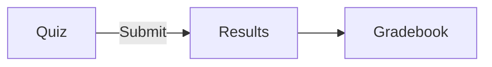
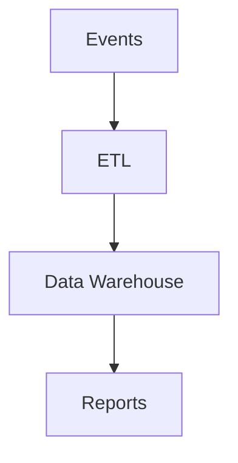
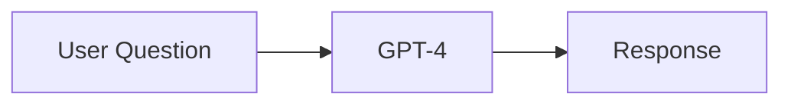
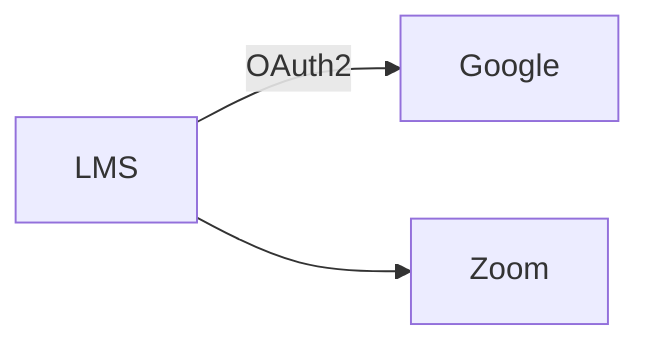
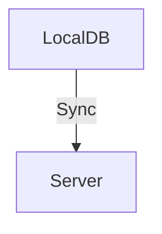
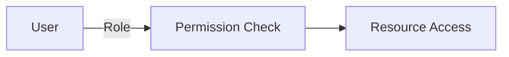
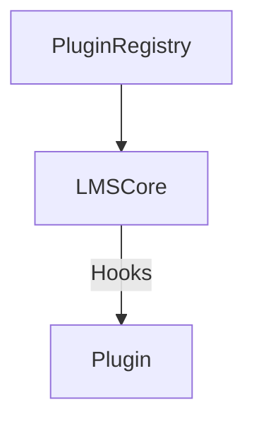

# Next-Generation AI-Powered Learning Management System Blueprint

## Phase 1: Product Vision & Roadmap

### Core Product Vision
- Deliver a modular, scalable LMS that supports AI tutoring and advanced analytics.
- Focus on accessibility, compliance (FERPA, GDPR, WCAG 2.2 AA), and minimal PII.
- Provide seamless integration with popular platforms (Zoom, Google Drive, etc.).
- Empower educators with rich authoring tools and extensible plugin system.
- Support mobile learning and offline-first capabilities.

### User Personas
1. **Student** – engages with course content, completes assessments.
2. **Instructor** – creates courses, tracks progress, reviews analytics.
3. **Administrator** – manages users, permissions, compliance.
4. **Developer** – builds plugins, integrations, and custom reports.

### Long-Term Goals
- Achieve 100k+ concurrent user support.
- Provide AI-driven recommendations and tutoring with explainability and user override.
- Foster an ecosystem of third-party plugins and extensions.

### Phased Roadmap
| Phase | Goal | Key Deliverables |
|------|------|-----------------|
| **MVP** | 0-3 months | Core course management, user auth, assessments, basic reporting |
| **Beta** | 4-6 months | Enhanced analytics, initial mobile app, plugin API preview |
| **GA** | 7-9 months | AI tutoring, scalability improvements, full mobile release |
| **Extensions** | 10+ months | AI Copilot, A/B testing, advanced LLM tutors |

## Phase 2: Subsystem Definition

Each subsystem is independently deployable, communicates via REST/GraphQL APIs, and follows the single-responsibility principle.

### 1. Course Management
**Purpose & Scope**: Manage courses, modules, lessons, enrollments.
**User Stories**:
- As an instructor, I can create courses with modules and lessons.
- As a student, I can enroll in a course and track my progress.
**AI Features**: Personalized course recommendations.
**PostgreSQL Schema**:
```sql
CREATE TABLE courses (
  id SERIAL PRIMARY KEY,
  instructor_id INT REFERENCES users(id),
  title VARCHAR(255) NOT NULL,
  description TEXT,
  created_at TIMESTAMP DEFAULT NOW()
);
```
**API Example**:
```ts
// Express route
app.post('/api/courses', auth('instructor'), async (req, res) => {
  const course = await db('courses').insert(req.body).returning('*');
  res.json(course);
});
```
**Code Snippet (React)**:
```tsx
export const CourseList: React.FC = () => {
  const { data } = useSWR('/api/courses');
  return (
    <ul>{data?.map(c => <li key={c.id}>{c.title}</li>)}</ul>
  );
};
```
**Mermaid**:


### 2. Authoring Tools
**Purpose & Scope**: WYSIWYG editors for lessons, media uploads, versioning.
**User Stories**:
- As an instructor, I can create and edit interactive lessons.
- As an admin, I can approve course content.
**AI Features**: Content grammar suggestions, automatic metadata tagging.
**PostgreSQL Schema**:
```sql
CREATE TABLE lesson_revisions (
  id SERIAL PRIMARY KEY,
  lesson_id INT REFERENCES lessons(id),
  content JSONB,
  created_at TIMESTAMP DEFAULT NOW()
);
```
**API Example** (GraphQL):
```ts
// Using NestJS GraphQL module
@Resolver(() => Lesson)
export class LessonResolver {
  @Mutation(() => Lesson)
  async createLesson(@Args('input') input: CreateLessonInput) {
    return this.lessonService.create(input);
  }
}
```
**Mermaid**:


### 3. Assessment Engine
**Purpose & Scope**: Quizzes, assignments, grading rubrics.
**User Stories**:
- As a student, I complete quizzes and receive feedback.
- As an instructor, I create graded assignments.
**AI Features**: Automated grading suggestions, plagiarism detection.
**PostgreSQL Schema**:
```sql
CREATE TABLE quizzes (
  id SERIAL PRIMARY KEY,
  course_id INT REFERENCES courses(id),
  title VARCHAR(255),
  config JSONB
);
```
**API Example**:
```ts
app.get('/api/quizzes/:id', auth(), async (req, res) => {
  const quiz = await db('quizzes').where('id', req.params.id).first();
  res.json(quiz);
});
```
**Mermaid**:


### 4. Analytics & Reports
**Purpose & Scope**: Dashboard for engagement, completion rates, and AI-driven insights.
**User Stories**:
- As an instructor, I review student progress and engagement.
- As an admin, I download compliance reports.
**AI Features**: Dropout prediction, cohort analysis.
**PostgreSQL Schema**:
```sql
CREATE TABLE analytics_events (
  id SERIAL PRIMARY KEY,
  user_id INT REFERENCES users(id),
  event_type VARCHAR(50),
  event_data JSONB,
  created_at TIMESTAMP DEFAULT NOW()
);
```
**API Example**:
```ts
app.get('/api/analytics/summary', auth('instructor'), async (req, res) => {
  const summary = await analyticsService.getSummary(req.user.id);
  res.json(summary);
});
```
**Mermaid**:


### 5. AI Engine
**Purpose & Scope**: Manage LLMs, embeddings, and recommendation pipelines.
**User Stories**:
- As a student, I chat with an AI tutor about course material.
- As an instructor, I receive automated insights on course effectiveness.
**AI Features**: GPT-4 based tutoring, Pinecone-powered semantic search.
**PostgreSQL Schema**:
```sql
CREATE TABLE ai_prompts (
  id SERIAL PRIMARY KEY,
  type VARCHAR(50),
  content TEXT,
  created_at TIMESTAMP DEFAULT NOW()
);
```
**API Example**:
```ts
app.post('/api/ai/chat', auth(), async (req, res) => {
  const response = await aiService.chat(req.body.message, req.user.id);
  res.json(response);
});
```
**Mermaid**:


### 6. Integration Layer
**Purpose & Scope**: Connect external services such as video conferencing, content repositories, and SSO.
**User Stories**:
- As an admin, I configure OAuth providers (Google, Microsoft).
- As a student, I join Zoom sessions directly from the LMS.
**AI Features**: Auto transcription and summarization of video content.
**PostgreSQL Schema**:
```sql
CREATE TABLE integrations (
  id SERIAL PRIMARY KEY,
  name VARCHAR(100),
  config JSONB,
  created_at TIMESTAMP DEFAULT NOW()
);
```
**API Example**:
```ts
app.post('/api/integrations', auth('admin'), async (req, res) => {
  const integration = await db('integrations').insert(req.body).returning('*');
  res.json(integration);
});
```
**Mermaid**:


### 7. Mobile App Layer
**Purpose & Scope**: React Native app with offline sync.
**User Stories**:
- As a student, I access content offline and sync progress when online.
- As an instructor, I manage courses from a tablet.
**AI Features**: Push notifications for personalized study reminders.
**PostgreSQL Schema**: N/A (uses existing tables).
**API Example**:
```ts
export const useOfflineSync = () => {
  const [pending, setPending] = useState([]);
  const sync = async () => {
    for (const item of pending) await api.post('/sync', item);
    setPending([]);
  };
  return { pending, sync };
};
```
**Mermaid**:


### 8. Admin & Role Management
**Purpose & Scope**: Handle roles, permissions, audit logs.
**User Stories**:
- As an admin, I assign roles to users and review audit logs.
- As an instructor, I request additional permissions when needed.
**AI Features**: Anomaly detection in access patterns.
**PostgreSQL Schema**:
```sql
CREATE TABLE roles (
  id SERIAL PRIMARY KEY,
  name VARCHAR(50) UNIQUE,
  permissions TEXT[]
);
CREATE TABLE user_roles (
  user_id INT REFERENCES users(id),
  role_id INT REFERENCES roles(id)
);
CREATE TABLE audit_logs (
  id SERIAL PRIMARY KEY,
  user_id INT REFERENCES users(id),
  action VARCHAR(100),
  details JSONB,
  created_at TIMESTAMP DEFAULT NOW()
);
```
**API Example**:
```ts
app.get('/api/admin/users', auth('admin'), async (req, res) => {
  const users = await db('users').select('*');
  res.json(users);
});
```
**Mermaid**:


### 9. Plugin/Extension System
**Purpose & Scope**: Allow third parties to extend LMS front-end and back-end.
**User Stories**:
- As a developer, I publish a plugin to the registry.
- As an admin, I enable or disable plugins per tenant.
**AI Features**: Plugin recommendation based on usage patterns.
**PostgreSQL Schema**:
```sql
CREATE TABLE plugins (
  id SERIAL PRIMARY KEY,
  name VARCHAR(100),
  version VARCHAR(20),
  manifest JSONB,
  enabled BOOLEAN DEFAULT TRUE,
  created_at TIMESTAMP DEFAULT NOW()
);
```
**API Example**:
```ts
app.post('/api/plugins', auth('admin'), async (req, res) => {
  const plugin = await db('plugins').insert(req.body).returning('*');
  res.json(plugin);
});
```
**Mermaid**:


## Phase 3: Architecture & Tech Stack

- **Frontend**: React + TypeScript
- **Backend**: Node.js with NestJS (or Express)
- **Database**: PostgreSQL for structured data, Redis for caching, Elasticsearch for search.
- **AI**: GPT-4 APIs, Pinecone embeddings, HuggingFace models as optional.
- **Mobile**: React Native with FCM for push notifications and offline support.
- **Auth**: OAuth2, SAML, JWT tokens with refresh.
- **Containerization**: Docker for each service, orchestrated via Kubernetes.
- **CI/CD**: GitHub Actions for pipeline automation.
- **Storage**: S3-compatible for assets.
- **Messaging**: Kafka for event streaming.

```mermaid
digraph G {
  frontend -> backend -> database;
  backend -> redis;
  backend -> elasticsearch;
  backend -> kafka;
  kafka -> ai;
  ai -> pinecone;
  mobile -> backend;
}
```

## Phase 4: DevOps & Deployment Plan

1. **Environments**: staging, production, and canary (blue/green).
2. **CI/CD Workflow**:
   - Lint → Unit Test → Build Docker Image → Push → Deploy via Helm.
3. **Monitoring**: Prometheus for metrics, Grafana dashboards.
4. **Logging**: ELK stack (Elasticsearch, Logstash, Kibana).
5. **Kubernetes**: Helm charts to deploy services.
6. **Dockerfiles**: Multi-stage builds for Node and React.

Example `Dockerfile`:
```Dockerfile
FROM node:18-alpine AS build
WORKDIR /app
COPY package*.json ./
RUN npm ci
COPY . .
RUN npm run build
FROM node:18-alpine
WORKDIR /app
COPY --from=build /app/dist ./dist
CMD ["node", "dist/main.js"]
```

Sample `deployment.yaml`:
```yaml
apiVersion: apps/v1
kind: Deployment
metadata:
  name: lms-backend
spec:
  replicas: 3
  selector:
    matchLabels:
      app: lms-backend
  template:
    metadata:
      labels:
        app: lms-backend
    spec:
      containers:
      - name: backend
        image: lms-backend:latest
        ports:
        - containerPort: 3000
```

GitHub Actions pipeline (`.github/workflows/ci.yml`):
```yaml
name: CI
on: [push]
jobs:
  build:
    runs-on: ubuntu-latest
    steps:
      - uses: actions/checkout@v3
      - uses: actions/setup-node@v3
        with:
          node-version: '18'
      - run: npm ci
      - run: npm run lint
      - run: npm test --if-present
      - run: npm run build
      - uses: docker/build-push-action@v3
        with:
          push: false
```

## Phase 5: Security, Compliance, and Accessibility

- **Compliance**: Adhere to FERPA and GDPR, storing minimal PII (name + email only). Provide data export/delete endpoints.
- **Accessibility**: WCAG 2.2 AA compliant UI components.
- **RBAC**: Role-based access controls with audit logging.
- **Sanitization**: Input validation using libraries like Joi or Zod.
- **Internationalization**: Full i18n support via libraries like `react-i18next` and locale files.

## Phase 6: Plugin Architecture

- **Front-end Plugin Slots**: Dynamic imports with React lazy loading.
  ```tsx
  const PluginSlot = ({ name }) => {
    const Plugin = React.lazy(() => import(`./plugins/${name}`));
    return (
      <React.Suspense fallback={null}>
        <Plugin />
      </React.Suspense>
    );
  };
  ```
- **Backend Hooks**: Event emitter pattern or use NestJS interceptors.
- **Manifest Format**:
```json
{
  "name": "MyPlugin",
  "version": "1.0.0",
  "permissions": ["read:courses", "write:grades"],
  "entry": "dist/plugin.js"
}
```
- **Registry UI**: Interface to upload, enable, disable, and update plugins with version checks and sandboxing.

## Phase 7: Output Samples

### API Endpoint (Express)
```ts
app.get('/api/courses/:id', auth(), async (req, res) => {
  const course = await db('courses').where('id', req.params.id).first();
  res.json(course);
});
```

### Frontend Component (React)
```tsx
export const CourseCard = ({ course }) => (
  <div className="card">
    <h3>{course.title}</h3>
    <p>{course.description}</p>
  </div>
);
```

### Offline Sync Hook (React Native)
```tsx
import { useEffect } from 'react';
import NetInfo from '@react-native-community/netinfo';

export const useOfflineSync = (onSync) => {
  useEffect(() => {
    const unsubscribe = NetInfo.addEventListener(state => {
      if (state.isConnected) onSync();
    });
    return () => unsubscribe();
  }, [onSync]);
};
```

### Dockerfile and K8s YAML
(Already shown above in DevOps section.)

### GitHub Actions CI Pipeline
(See `.github/workflows/ci.yml` snippet above.)

## Phase 8: Final Milestone Plan

| Timeline | Goals |
|----------|-------|
| **3-month MVP** | Course management, basic assessments, user auth, initial CI/CD pipeline |
| **6-month Beta** | Mobile app preview, analytics dashboards, plugin API beta |
| **9-month GA** | AI tutor, scale to 100k+ users, full plugin registry |
| **12+ months** | AI copilot for instructors, A/B testing framework, advanced LLM tutors |

